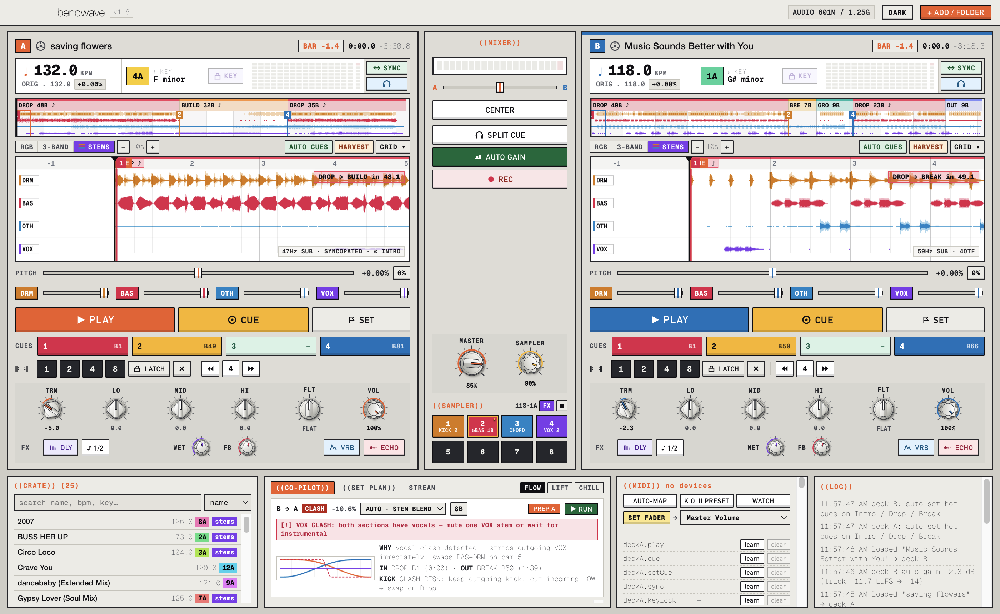
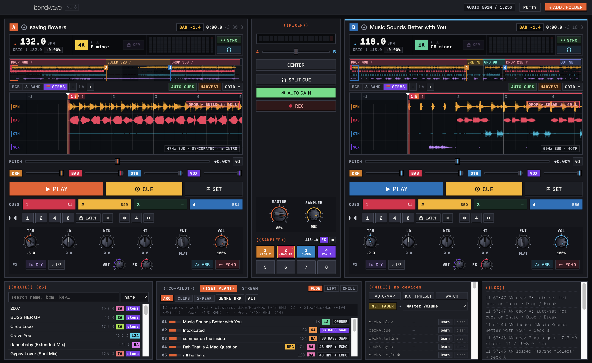

<div align="center">

# bendwave

**A Teenage Engineering & Boeing 737 cockpit-inspired, stem-aware two-deck DJ instrument.**

Deterministic local DSP — acoustic fingerprinting, graph-theoretic set path planning, live automated transition curves with instant touch-to-override, and an MIR stem-to-pad sampler for live callbacks. Zero cloud latency.


<br />



</div>

---

## DJ Philosophy

**bendwave** is built around a specific point of view on live mixing — one where taste and crate-digging drive the room, and the software acts as a musical co-pilot rather than a wall of menus or a black-box autopilot.

### 1. Curation Leads; Mechanics Follow by Osmosis
The hard 80% of DJing is the ear — noticing why a particular 38 Hz 808 decay, a wet house kick, or a two-bar vocal pocket belongs right after another record. Beatmatching, phrase counting, bass swaps, and filter sweeps are physical muscle memory. **bendwave** lets your ear stay in front while training your hands in real time: hit **`▶ RUN`** to watch the Boeing 737 `LO` and `FLT` dials execute an 8-bar transition on your own tracks, then reach out and grab a single knob mid-sweep. Touch-to-override immediately hands that control to you while the rest of the transition finishes cleanly.

### 2. Acoustic Physics Over Genre Labels
Genre tags break down the moment you play hybrid, underground, or unreleased records. Instead of brittle *"House / UKG / Trap"* classifiers, **bendwave** measures the physical sound of each track directly from PCM audio:
- **Low-end anatomy:** peak sub frequency (`38 Hz` 808 vs `59 Hz` house kick) and sub sustain (`TIGHT` vs `ROLLING`).
- **Rhythmic geometry:** 16-step bar-folded low-end groove (`4OTF`, `SYNCOPATED`, `TRAP/HALF`) and downbeat-aligned 16th-note swing (`STRAIGHT` vs `SWUNG`).
- **Perceived energy & room timbre:** loudness-normalized dancefloor energy (immune to brickwall mastering bias) and 13-band MFCC timbre.
- **Harmonic null-nodes (`∅`):** energy-gated drum-only intros/outros — plus isolated 4-beat `DRM` stem loops (`STEM ∅`) — that intentionally reset harmonic tension so you can bridge a Camelot key clash cleanly instead of forcing two clashing chord progressions together.

### 3. Sets as Directed Graphs, Not Sorted Playlists
A real set is not a BPM-sorted spreadsheet; it is a no-repeat journey across sonic pockets. **bendwave** models your crate as a directed weighted graph (log-tempo with half/double-time wrapping, directed Camelot cost, MFCC room similarity, swing and groove compatibility), discovers unsupervised pockets and **`BRG` bridge tracks** that connect them, and solves full room arcs (**`ARC`** warmup → peak → cooldown, **`CLIMB`**, or **`2-PEAK`**) in ~6 ms.

### 4. Live Set Memory & Callbacks — Instrument, Not a DAW
Full DAWs kill spontaneous club flow. Even artists who perform live on Ableton ignore 95% of it on stage, living inside tempo-locked audio clips, a filter, a delay, and tactile pads. **bendwave** stays intentionally bounded to an 8-pad **Harvested DNA Sampler**: pull a wet kick from track 2, a UKG bass wobble from track 6, a chord stab from track 7, or a vocal phrase from track 9 and keep them alive under your fingers 20 minutes later — automatically tempo-warped and Camelot pitch-locked into whatever record is playing now. Bringing back a sonic motif from earlier in the night turns separate tracks into a single coherent story.

### 5. Tactile, Shape-Coded Hardware Ergonomics
Inspired by Braun / Dieter Rams 70–20–10 color blocking, Teenage Engineering's EP–133 K.O. II, and the Boeing 737 flight deck: quiet putty/stone utility surfaces, charcoal tactile pads, solid functional transport colors, and three distinct cockpit rotary knob silhouettes so your peripheral vision knows what a control does before reading a label.

<details>
<summary><strong>Preview Dark Booth Mode &amp; Graph Set Path Planner</strong></summary>
<br />

</details>

---

## Capabilities (`v1.6`)

| Pillar | Capability | Highlights |
| :--- | :--- | :--- |
| **Dual Decks & Stems** | Two sample-aligned Web Audio decks + 4-stem Demucs separation (`DRM / BAS / OTH / VOX`) | Instant Serato BeatGrid / `TBPM` / `TKEY` ID3 reader, recursive folder drag-and-drop, 3-band EQ, LP/HP filter, beat-synced delay (`♬ 1/4` · `♪ 1/2` · `♪· 3/4` · `♩ 1/1`), reverb, momentary Echo Out, `-14 LUFS` Auto-Gain, Split-Cue, streaming WAV recorder (`~/Music/bendwave/`), Signalsmith Stretch WASM Key Lock. |
| **Arrangement & Waveforms** | Dual theme-aware canvases (`RGB` · `3-BAND` · `4-STEMS`) + Arrangement Ribbon | Bar-synchronous `INTRO / BUILD / DROP / BREAK / GROOVE / OUTRO` detection + `♪` vocal badges once stems finish, floating phrase countdown pill (`DROP → BUILD in 48.1`), 1-click `AUTO CUES`, collapsible `GRID ▾` popover (`⚑ 1`, `◀1/1▶`, `±10ms`, `½×/2×`, `4/4`, `8B`). |
| **Deep Acoustic Fingerprint** | ~60 ms pure TypeScript DSP per track | 13-dim MFCC timbre vector, peak sub frequency (`35Hz 808` vs `59Hz SUB`), sub sustain, 16-step low-end groove, downbeat-aligned 16th-note swing, stereo width, loudness-normalized `danceEnergy`, and energy-gated `∅` drum-only intro/outro scores. |
| **Graph Set Path Planner** | `((SET PLAN))` tab — ~6 ms Beam Search + 2-opt solver | Strictly no-repeat set arcs (`ARC`, `CLIMB`, `2-PEAK`), crate clustering, `BRG` bridge track discovery, `GENRE BRK` toggle for intentional echo-out tempo resets, and `ALT` path exploration. |
| **Automated Transitions** | `((CO-PILOT))` tab — 6 live executable curve strategies | Auto-selects `BASS SWAP`, `HPF + ECHO`, `LPF IN`, `X-FILTER`, `STEM ∅` (4-beat drums-only key-clash reset), or `STEM BLEND` (strips clashing `VOX`, swaps `BAS+DRM` on bar 5), with visual envelope preview and live touch-to-override. |
| **Harvested DNA Sampler** | MIR Stem-to-Pad Harvester (`HARVEST`, `⇧+drag`, `⌥-click` stem) | 12-bin Chromagram Self-Similarity hooks, Spectral Tonality + Chroma Novelty `OTH` synth riffs & chord stabs, cosine-diverse `VOX` chops (never duplicate choruses), isolated `DRM` & `808` onset hits, **0 ms attack** leading-silence & STFT latency trim, `★ Pin` + `HARVEST` Re-Roll, live Signalsmith BPM warp + Camelot key-lock with vocal formant preservation, beat-synced Space FX, and 1-click `.wav` export for the physical K.O. II. |
| **Hardware & Tactile UI** | Putty Day & Dark Booth modes · 13" MacBook Pro ready | 3 original Boeing 737 SVG rotary knob archetypes (`EFIS 4-Lobe`, `Overhead Wedge`, `EFIS 8-Scallop`), proportional Force Touch trackpad gliding, right-click EQ isolator kill switches, native macOS Touch Bar live DJ strip, integrated frameless macOS titlebar, custom hardware hover placards, and class-compliant USB MIDI (`EP–133 K.O. II` preset + 1-click assignable `SET FADER →` strip + Pitch Bend). |

---

## Architecture

```text
  Local Folder / Audio / SoundCloud Stream
         │
         ├──► Instant TS DSP (~60ms/track, offline)
         │      ├─ id3.ts          Serato BeatGrid, TBPM, TKEY tags
         │      ├─ analysis.ts     BeatGrid fallback, LUFS Auto-Gain
         │      ├─ structure.ts    INTRO / BUILD / DROP / BREAK / OUTRO + AUTO CUES
         │      └─ fingerprint.ts  13-dim MFCC, peakSubHz, 16-step groove, swing, ∅ nodes
         │
         ├──► Background Python Sidecar (Apple Silicon MPS, private venv)
         │      └─ tools/analyze.py  librosa key + Demucs 4-stems (DRM / BAS / OTH / VOX)
         │
         ├──► Intelligence & Performance Engine (src/renderer/engine/)
         │      ├─ planner.ts      Directed Crate Graph → Beam Search + 2-opt Set Paths
         │      ├─ copilot.ts      Top-5 Next Up + Transition Recipe + [!] VOX CLASH
         │      ├─ transition.ts   6 live curve envelopes + instant touch-to-override
         │      ├─ harvester.ts    Chroma SSM + Tonality + Cosine Diversity + 0ms trim
         │      └─ sampler.ts      8-pad DNA sampler + offline Signalsmith warp/key-lock
         │
         └──► Native C++ Real-Time Audio Graph (Web Audio API + Signalsmith WASM)
                └─ Deck A / Deck B ─► 3-Band EQ ─► LP/HP + Delay/Reverb/Echo ─► Crossfader ─► Master / Split-Cue / WAV Rec
```

---

## Quick Start

### Run from Source (macOS Apple Silicon)

```bash
git clone https://github.com/vidyut-19/bendwave.git
cd bendwave
npm install
npm run dev
```

### Build Packaged macOS `.app` & `.dmg`

```bash
npm run typecheck
npm run dist
# Output: release/bendwave-1.6.0-arm64.dmg (ad-hoc signed via scripts/adhoc-sign.cjs)
```

> **Note when sharing the unsigned DMG between Macs:** After dragging `bendwave.app` into `/Applications`, clear AirDrop's quarantine flag once with `xattr -cr /Applications/bendwave.app`.

### Optional: Enable 4-Stem Separation (Demucs + Apple Silicon MPS)

The DMG stays lightweight (~101 MB) by keeping Python/PyTorch out of the bundle. To unlock 4-stem separation and `librosa` key detection:

1. Ensure Python 3.12 + `ffmpeg` are installed (`brew install python@3.12 ffmpeg`).
2. Click **`+ STEMS`** in `bendwave`'s top header once — it builds an isolated private venv in `~/Library/Application Support/bendwave/pyenv` automatically.

---

## Controls & Hardware Rig

### Laptop / Trackpad (Zero External Controller Needed)

| Gesture / Control | Action |
| :--- | :--- |
| **Hover Boeing Knob + 2-finger glide** | Analog-smooth proportional tuning (hold `Shift` for 4× fine precision) |
| **Double-click any knob / fader** | Snap to detent (`0.0 dB` / `FLAT` / `CENTER` / `0%`) |
| **Right-click `LO` / `MID` / `HI` knob** | Instant DJM-style **Isolator Kill** toggle (`-26 dB ↔ 0.0 dB`) |
| **Hover Crossfader / Pitch + 2-finger swipe** | Smooth crossfade or tempo ride |
| **`⇧ + Drag` on `STEMS` waveform** | Harvest any exact beat/bar slice off a specific stem lane onto a pad |
| **`⌥ + Click` `DRM/BAS/OTH/VOX` pill** | Grab live playhead beat/bar onto next open pad |
| **`⌘ + Click` any Sampler Pad** | **`★ Pin`** pad so it stays locked while clicking `HARVEST` to re-roll |
| **Right-click any Sampler Pad** | Toggle `ONE-SHOT / SYNC LOOP`, `KEY LOCK`, `SPACE FX`, or **`EXPORT .WAV (K.O. II)`** |

### Native macOS Touch Bar (2020 M1 MacBook Pro)

```text
[ DECK A/B ]  [ LO | FLT | VOL | MID | HI | XF ]  [ ━━━ CONTINUOUS OLED SLIDER ━━━ ]  [ 0 ]  [ KILL ]
```

### Keyboard Shortcuts

| Keys | Deck A | Deck B | Mixer / Global |
| :--- | :--- | :--- | :--- |
| **Play / Cue / Set / Sync** | `Q` / `W` / `E` / `R` | `P` / `O` / `I` / `U` | `,` / `.` / `Space` Crossfader |
| **Hot Cues 1–4** (`⇧` sets) | `A` `S` `D` `F` | `J` `K` `L` `;` | `X` Split Cue · `C` Auto-Gain · `V` Record |
| **Loop Rolls 1/2/4/8** / Latch | `4` `5` `6` `7` / `T` | `B` `N` `M` `'` / `Y` | `[` `]` Beat Jump · `\` Jump Size |
| **Echo Out / Headphone PFL** | `G` / `Z` | `H` / `/` | `⇧ + 1–8` Trigger Sampler Pads 1–8 |
| **Pitch Bend / Key Lock** | `1` `2` / `3` | `9` `0` / `8` | `Esc` Close Popovers / Overlays |

### USB MIDI & EP–133 K.O. II

Click **`K.O. II PRESET`** in `((MIDI))` for instant 4-group mapping (leaving BPM unmapped):
- **Group A** (`36–47`): Deck A Play, Cue, Set, Sync, Hot Cues 1–4, Echo Out, Delay, Frac, Reverb
- **Group B** (`48–59`): Deck A Hot Cue setters, PFL, Key Lock, Loop Rolls `1/2/4/8`, Exit, Latch
- **Group C** (`60–71`): Deck B Play, Cue, Set, Sync, Hot Cues 1–4, Echo Out, Delay, Frac, Reverb
- **Group D** (`72–83`): **Velocity-sensitive Harvested DNA Sampler Pads 1–8** (`72–79`) + Deck B Loops `1/2/4/8` (`80–83`)
- **`SET FADER →` strip:** Bind your K.O. II bottom-left fader once (CC or Pitch Bend), then flip its target live between **Master Volume**, **Crossfader**, **Active Deck Vol/BPM/Filter/Low EQ**, or **Sampler Vol**.

---

## Docs & Further Reading

- **[QUICKSTART.md](QUICKSTART.md)** — 60-second setup for K.O. II + headphones + Split-Cue
- **[ROADMAP.md](ROADMAP.md)** — Full 6-Pillar engineering blueprint
- **[docs/bendwave-ko2-manual.pdf](docs/bendwave-ko2-manual.pdf)** — 2-page printable TE-style K.O. II field manual
- **[docs/bendwave-session-notes.pdf](docs/bendwave-session-notes.pdf)** — 4-page e-reader field essay & architecture notes
- **[docs/streaming.md](docs/streaming.md)** — Optional SoundCloud OAuth setup

---

## License & Acknowledgments

MIT License. Built on open-source foundations: [Electron](https://www.electronjs.org/), [Vite](https://vite.dev/), [Signalsmith Stretch](https://signalsmith-audio.co.uk/code/stretch/), [Demucs](https://github.com/facebookresearch/demucs), [librosa](https://librosa.org/), [PyTorch](https://pytorch.org/), and [Geist Mono](https://vercel.com/font). Industrial design inspired by Braun, Teenage Engineering, and the Boeing 737 flight deck (independent project; not affiliated with or endorsed by those brands).
